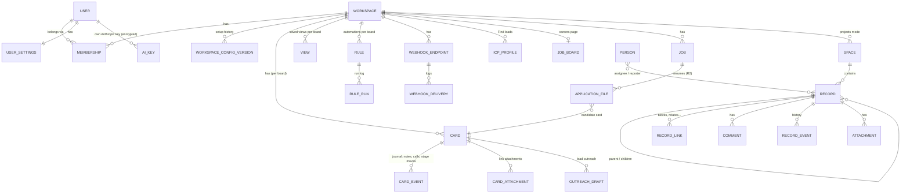

# Data model (sketch)

A simplified view of the main entities in Cloudflare D1. Columns are omitted on purpose; only the key relations are shown. Every business table is scoped by workspace.

## Notes

- **Workspace.** A separate CRM. A user can belong to several workspaces with a role (admin or member); there is also a personal workspace per account.
- **Board setup is versioned.** Stages, custom fields, reminders and wording are stored as numbered versions per workspace. That is what makes dry runs, diffs and rollback possible.
- **Cards.** One table holds the cards of every board (AI CRM, Lead generation, Receptionist, Support, Hiring and user-defined boards). Custom field values live with the card. Formula and rollup fields are computed on read.
- **Projects mode** is a separate, Jira-like model: spaces, records with human-readable keys, hierarchy, links, comments and history. Imported records keep their external ids so re-imports stay idempotent.
- **Demo data** from templates is flagged and can be cleared without touching real cards.
- **Files.** Resume files go to a private R2 bucket. The database holds only metadata and extracted text. Nightly D1 backups go to a separate private R2 bucket.
- **Supporting tables** (not shown) cover usage counters, product events, onboarding state and admin audit logs.
